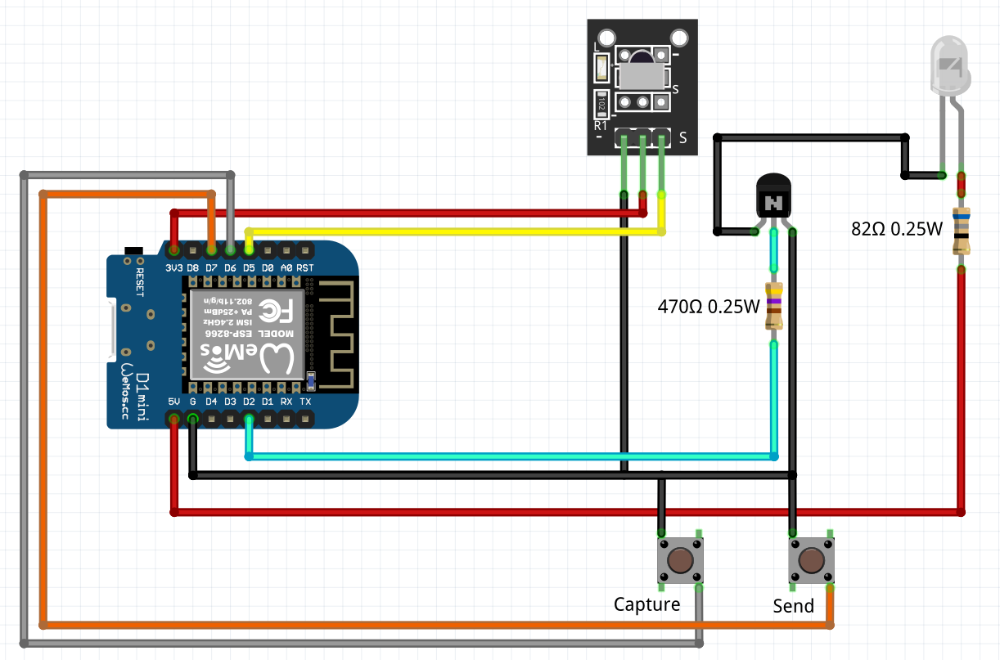

# BeamBandit: V2.0 (Operation: Dark Pulse)

An interactive ESP8266-powered hardware/firmware IR cloner and web-controlled protocol analyzer built to capture, decode, store, and replay infrared signals in real time.

> **Project Nexus Suite:** Beam Bandit is an official sub-project developed and maintained under the **Project Nexus**

## Setup & Firmware Flashing

### Arduino IDE

```bash
# Clone the repository and navigate into it
cd beam-bandit

# Open the main source sketch and header files in Arduino IDE
# Files required in the same directory: Beam_Bandit.ino and webfiles.h

# Install required library dependencies via Library Manager/PlatformIO:
# - ESPAsyncWebServer
# - IRremoteESP8266

# Connect your WeMos D1 Mini hardware via USB
# Select Board: WeMos D1 R2 & mini (or ESP8266 equivalent) and select the proper COM port

# Compile and Upload firmware to the device
```
# Circuit Schematic

# Files
- Beam_Bandit.ino – Core embedded firmware engine containing GPIO pin mappings for the IR receiver/transmitter, tactile buttons, hardware debounce logic, state machine controllers, and the Asynchronous Web Server instance.   

- webfiles.h – Header file containing the embedded responsive HTML/CSS/JS control dashboard (BEAM BANDIT V2.0) served directly by the ESP8266 access point. 
 
- Circuit.png – Wiring schematics and circuit topology diagram detailing pin connections for the D1 Mini, IR demodulator, high-output IR LED, transistors, current-limiting resistors, and trigger pushbuttons.  

# Project Features
- Beam Bandit (Operation: Dark Pulse) is a portable hardware utility designed for security auditors to perform physical layer analysis on infrared-controlled infrastructure. By capturing raw pulse-width modulation (PWM) IR timings via an onboard demodulator sensor, Beam Bandit automates local signal cloning, web-dashboard telemetry tracking, and hardware-triggered replay attacks.  

- Wi-Fi AP Control Deck: Hosts a localized Asynchronous Web Server allowing operators to monitor system states, visualize raw captured timing registers, and trigger transmissions remotely via smartphone or laptop.   

- Hardware & Web Capture Modes: Features physical tactile capture/send pushbuttons alongside web API endpoints (/api/capture, /api/send, /api/fire_live) for dual-control flexibility.   

- Non-Volatile Session History: The web interface dynamically saves, logs, and catalogs captured signal arrays into a local history deck for quick reloading and testing.   
- Targeted Replay Attack Utility: Emits exact optical raw timing patterns via a dedicated high-output IR transmission circuit driven by an ESP8266 GPIO output.  
